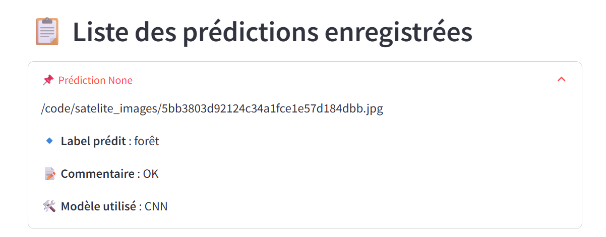

# Classification d'images satellites - Ticket 2

Application de classification d'images satellites à partir d'un réseau de
neurones convolutif (CNN). Elle prédit la catégorie d'une image parmi quatre
classes : nuageux, désert, forêt et mer.

L'application est composée de trois services orchestrés avec Docker Compose :
une API FastAPI qui exécute la prédiction et enregistre le résultat, une base
de données MySQL (avec Adminer), et un client Streamlit pour déposer une image
et consulter les prédictions.

## Lancement

Créer un fichier `.env` à la racine à partir des variables attendues (voir le
fichier `docker-compose.yml`), puis depuis la racine du projet :

```
docker compose up --build -d
```

| Service | Adresse |
| --- | --- |
| Client Streamlit | http://localhost:8501 |
| Documentation API | http://localhost:8081/docs |
| Adminer | http://localhost:8080 |

Pour arrêter :

```
docker compose down
```

## Correction apportée

Le bug du ticket venait de l'enregistrement en base. La fonction qui sauvegarde
une prédiction n'utilisait pas le label réellement prédit : elle insérait
toujours le premier label de la table, c'est à dire « forêt ». Toute prédiction
était donc stockée comme « forêt », d'où l'image de désert affichée en « forêt »
dans la liste des prédictions enregistrées.

La correction recherche l'identifiant du label correspondant au label prédit et
l'enregistre. La fonction de lecture a aussi été corrigée pour renvoyer toutes
les prédictions et leur identifiant.

## Suivi ajouté

Pour la partie surveillance, le modèle renvoie désormais un indice de confiance,
chaque prédiction est journalisée (label, confiance, durée) et une page
« Dashboard » a été ajoutée au client. Elle affiche le nombre de prédictions, la
confiance moyenne du modèle, la répartition par classe et une alerte si la
confiance moyenne passe sous un seuil.

La documentation du dashboard se trouve dans `docs/dashboard.md`.

## Énoncé du ticket

### Étapes pour reproduire le problème

1. Lancer l'application.
2. Ajouter une image satellite du désert sur la page Upload image.
3. Envoyer.
4. Le label de la prédiction indique un désert.
5. Passer sur la page Voir les prédictions.
6. Dérouler la dernière prédiction de la liste des prédictions enregistrées.
7. Le label prédit est forêt.

### Résultat actuel

Le label dans la liste des prédictions enregistrées n'est pas le bon ; il
affiche forêt à la place de désert.



### Comportement attendu

Le label prédit doit afficher désert.
